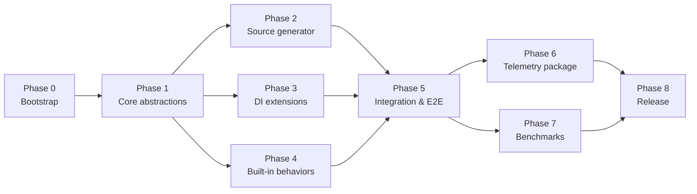

# FastMediatR — Implementation Task Breakdown

> **Version:** 1.4  
> **Date:** 2026-05-25  
> **Companion to:** [260524_1200-fastmediatr-design.md](260524_1200-fastmediatr-design.md) (v1.7)  
> **Companion to:** [260524_1300-fastmediatr-usage-guide.md](260524_1300-fastmediatr-usage-guide.md) (living document)  
> **Governing standards:** [DotNet.md](DotNet.md)

This document decomposes the FastMediatR v1.0 implementation into eight phases. Each phase is independently buildable and ends with a hard gate: **code review + unit tests passing + sample Web API updated + usage guide updated + design document reconciled**. No phase may be marked complete until all five gate items are signed off.

> **Tracking convention:** every task row has a **Done** column with `☐`. Flip it to `☑` when the task is complete. Markdown table cells do not render clickable `- [ ]` checkboxes, so unicode boxes are used to display consistently across VS Code, GitHub, and other Markdown viewers. The Universal DoD list and Phase Progress Summary at the bottom of this document use the same convention.

---

## Phase Conventions

Every phase ends with the same five mandatory closing tasks. They are not optional polish — they are the gate.

| # | Closing Task | Definition of Done |
|---|--------------|--------------------|
| **R** | **Code review** | All code touched in the phase is reviewed by a second engineer (or self-review checklist if solo). Reviewer signs off in the PR. Checklist: DotNet.md §1–18 compliance, public API surface stable, XML docs present, no `// TODO` left, no warnings, no suppressions. |
| **T** | **Unit tests** | xUnit v3 tests cover every public type added in the phase. Positive + negative + edge cases. Code coverage ≥ 90 % on new code. `dotnet test` green on the CI matrix (ubuntu + windows + macos). |
| **S** | **Sample Web API update** | The `samples/FastMediatR.Sample.Api` project demonstrates every public API or feature shipped in the phase. Endpoints exercise the new surface end-to-end; Swagger annotations updated; the sample builds and runs against the in-tree projects (project references, not NuGet). See [Cross-Phase Deliverables](#cross-phase-deliverables). |
| **U** | **Usage guide update** | The companion document [260524_1300-fastmediatr-usage-guide.md](260524_1300-fastmediatr-usage-guide.md) is updated to document every new feature shipped in the phase: motivation, snippet copied from the sample API, configuration knobs, gotchas. A new entry is added to the guide's changelog at the top. |
| **D** | **Design doc update** | Any deviation from the design document (signature change, additional helper type, renamed concept, behavior change, new trade-off discovered) is reflected back into [260524_1200-fastmediatr-design.md](260524_1200-fastmediatr-design.md) with a one-line changelog entry at the top of the relevant section. If nothing changed, state that explicitly in the PR description. |
| **C** | **CHANGELOG update** | A `### Added / Fixed / Changed` section for the phase is prepended to `CHANGELOG.md` under `## [Unreleased]`. Every public type added, every bug fixed, and every breaking change must appear here. Format follows [Keep a Changelog](https://keepachangelog.com/en/1.1.0/). |

If a phase has no production code (e.g. infrastructure-only phases), the **T** gate is replaced with the equivalent verification (smoke test, build step, generator snapshot). The **S** gate is replaced with "sample project scaffolded / builds clean" until Phase 1 ships consumable APIs.

---

## Cross-Phase Deliverables

Two artifacts live and grow alongside the library itself. Every phase must leave both in a coherent, runnable, and accurate state.

### 1. Sample Web API — `samples/FastMediatR.Sample.Api`

A single ASP.NET Core minimal-API project demonstrating every public-facing feature of FastMediatR. It is **not** a test project — its job is to serve as the canonical, copy-pasteable reference for users of the library.

**Scope by completion (cumulative through phases):**

- `AddFastMediatR<Program>(...)` registration (Phase 3)
- Command, query, void-command (`IRequest` → `Unit`) endpoints (Phase 2/3)
- Notification publish endpoint with multiple handlers (Phase 2/3)
- Custom `IPipelineBehavior<,>` (Phase 4)
- Built-in `ValidationBehavior` with FluentValidation validators (Phase 4)
- Built-in `LoggingBehavior` + `PerformanceBehavior` wired into the pipeline (Phase 4)
- Pre-/post-processors wired via `AddOpenBehavior` (Phase 4)
- Switching `INotificationPublisher` strategy via config (Phase 4)
- `[HandlerLifetime]` override demonstrated on at least one handler (Phase 3)
- Untyped `Send(object)` endpoint (Phase 2)
- OpenTelemetry tracing via `FastMediatR.Telemetry` (Phase 6)
- Swagger / OpenAPI documentation for every endpoint
- `README.md` inside the sample folder with run instructions

**Conventions:**

- Project references the in-tree FastMediatR projects directly (no NuGet) so it always tracks `main`.
- Excluded from the `FastMediatR.slnx` `pack` target; built and run as part of CI but not published.
- Each feature is grouped into its own endpoint route (`/commands`, `/queries`, `/notifications`, `/behaviors`, `/telemetry`).
- Code must satisfy the same DotNet.md §1–§18 rules as the library itself.

### 2. Usage Guide — `docs/260524_1300-fastmediatr-usage-guide.md`

A living, comprehensive end-user document covering installation, configuration, every feature, idiomatic patterns, and migration from MediatR. Code snippets in the guide must be **copied verbatim from the sample API** (or at least kept in lockstep) so they are guaranteed to compile.

**Required sections (filled in incrementally as features land):**

1. Introduction & goals
2. Installation (`dotnet add package FastMediatR`)
3. Quick start (10-line minimal example)
4. Core concepts: requests, notifications, handlers, `Unit`
5. Dependency injection (`AddFastMediatR<TMarker>`, lifetimes, multi-assembly scanning)
6. Pipeline behaviors (custom + built-in: Validation, Logging, Performance)
7. Pre- and post-processors
8. Notification publishing strategies (`TaskWhenAllPublisher`, `SequentialAwaitPublisher`)
9. Source-generator diagnostics (FM001 / FM002 / FM003)
10. Configuration & options (`FastMediatROptions`)
11. Observability (`FastMediatR.Telemetry` + OpenTelemetry)
12. AOT & trimming guidance
13. Migration from MediatR (table + worked example)
14. Troubleshooting & FAQ
15. Performance characteristics (link to benchmarks)
16. Changelog (top-of-document, newest entry first)

---

## Phase 0 — Repository & Toolchain Bootstrap

**Goal:** Land an empty, CI-green repository that enforces every DotNet.md §18 rule from the first commit.

| Done | # | Task | Output |
|:----:|---|------|--------|
| ☑ | 0.1 | Create solution `FastMediatR.slnx` and the empty project layout from design §3 (5 src projects, 4 test projects, 1 benchmark project). | `.slnx` + empty `.csproj` files |
| ☑ | 0.2 | Add repo-root `Directory.Build.props` per design §17 (Nullable, ImplicitUsings, TreatWarningsAsErrors, AnalysisLevel, GenerateDocumentationFile, IsAotCompatible, IsTrimmable). | `Directory.Build.props` |
| ☑ | 0.3 | Add repo-root `.editorconfig` enforcing DotNet.md §18 (file-scoped namespaces, `var` rules, blank line before `if`, one-class-per-file). | `.editorconfig` |
| ☑ | 0.4 | Add `.gitignore`, `.gitattributes`, `LICENSE` (MIT), `README.md` stub, `CHANGELOG.md`. | Repo hygiene files |
| ☑ | 0.5 | Add `Directory.Packages.props` for centrally-managed NuGet package versions. | CPM enabled |
| ☑ | 0.6 | Create `.github/workflows/ci.yml` from design §14 (matrix os, `dotnet format --verify-no-changes`, build, test, pack). | CI yaml |
| ☑ | 0.7 | Scaffold `samples/FastMediatR.Sample.Api` (ASP.NET Core minimal API, .NET 10) with project references to in-tree FastMediatR projects. Add a placeholder `/health` endpoint. Add `samples/FastMediatR.Sample.Api/README.md`. | Sample project skeleton |
| ☑ | 0.8 | Create `docs/260524_1300-fastmediatr-usage-guide.md` skeleton with the 16 section headings from [Cross-Phase Deliverables](#cross-phase-deliverables) and an empty changelog block. | Usage guide skeleton |
| ☐ | **0.R** | **Code review** — sign-off on hygiene baseline, sample skeleton, usage guide skeleton. | PR approval |
| ☑ | **0.T** | **Build verification** — `dotnet build` + `dotnet format --verify-no-changes` green on all 3 OSes; sample API builds and `/health` returns 200. | CI green |
| ☑ | **0.S** | **Sample API** — skeleton committed, builds clean, `/health` endpoint live. | Sample runs |
| ☑ | **0.U** | **Usage guide** — skeleton committed with all 16 section headings + changelog block. | Guide skeleton present |
| ☑ | **0.D** | **Design doc** — confirm §3 / §14 / §17 match exactly what was scaffolded; add the sample project + usage guide to the project layout listing in §3. | Changelog entry or "no changes" |
| ☑ | **0.C** | **CHANGELOG** — add `### Added — Phase 0` section to `CHANGELOG.md` listing repo scaffold, CI workflow, and sample skeleton. | `CHANGELOG.md` |

---

## Phase 1 — Core Abstractions (`FastMediatR.Core`)

**Goal:** Ship the public interface surface. No dispatch logic, no DI, no generator. Just the contract that everything else builds against.

| Done | # | Task | Output |
|:----:|---|------|--------|
| ☑ | 1.1 | Implement `Unit` (`readonly record struct`) — design §5.1. | `Unit.cs` |
| ☑ | 1.2 | Implement marker interfaces `IBaseRequest`, `IRequest<TResponse>`, `IRequest : IRequest<Unit>`, `INotification` — design §5.2. | One file per interface |
| ☑ | 1.3 | Implement handler interfaces `IRequestHandler<TRequest, TResponse>`, `IRequestHandler<TRequest>`, `INotificationHandler<TNotification>` — design §5.3. | One file per interface |
| ☑ | 1.4 | Implement sender / publisher / mediator interfaces `ISender`, `IPublisher`, `IMediator : ISender, IPublisher` — design §5.4. | One file per interface |
| ☑ | 1.5 | Implement `RequestHandlerDelegate<TResponse>(CancellationToken)` and `IPipelineBehavior<TRequest, TResponse>` — design §5.5. | Delegate + interface |
| ☑ | 1.6 | Implement `IRequestPreProcessor<TRequest>` and `IRequestPostProcessor<TRequest, TResponse>` — design §5.6. | One file per interface |
| ☑ | 1.7 | Implement `INotificationPublisher` interface and `NotificationHandlerExecutor` record struct — design §10.1. | Interface + record struct |
| ☑ | 1.8 | Implement `[HandlerLifetime]` attribute — design §5.7. | Attribute file |
| ☑ | 1.9 | Full XML documentation on every public symbol (DotNet.md §18). | Triple-slash comments |
| ☐ | **1.R** | **Code review** — verify public API matches design §5 exactly; no unintended types leaked. | PR approval |
| ☑ | **1.T** | **Unit tests** — `Unit` equality / `ToString` / `Value`, `IRequest<Unit>` inheritance, all interfaces compile-only smoke tests via xUnit. | `FastMediatR.Tests/Core/*` |
| ☑ | **1.S** | **Sample API** — add example `Commands/`, `Queries/`, `Notifications/` folders with one type each, illustrating the new core abstractions (compile-only at this phase — no dispatch yet). | Sample folders + types |
| ☑ | **1.U** | **Usage guide** — fill in §1 Introduction, §3 Quick start (stub), §4 Core concepts (requests, notifications, handlers, `Unit`); add changelog entry. | Sections 1, 3 (partial), 4 |
| ☑ | **1.D** | **Design doc** — reconcile §5 with shipped surface. | Changelog entry |
| ☑ | **1.C** | **CHANGELOG** — add `### Added — Phase 1` section to `CHANGELOG.md` listing all core abstraction types. | `CHANGELOG.md` |

---

## Phase 2 — Source Generator (`FastMediatR.Generator`)

**Goal:** The Roslyn `IIncrementalGenerator` that emits `FastMediatRDispatcher` + `FastMediatRGeneratedRegistration` for any consumer assembly. This is the single largest piece of differentiating work.

| Done | # | Task | Output |
|:----:|---|------|--------|
| ☑ | 2.1 | Project setup: `<IsRoslynComponent>true</IsRoslynComponent>`, `netstandard2.0` TFM, reference `Microsoft.CodeAnalysis.CSharp` analyzer-only. | `.csproj` |
| ☑ | 2.2 | Discovery pipeline: collect every concrete type implementing `IRequestHandler<,>` or `INotificationHandler<>` from the compilation. Use `ForAttributeWithMetadataName` where possible for incrementality. | `HandlerDiscoveryProvider.cs` |
| ☑ | 2.3 | Validation: emit **FM001** (no handler for request type that is `Send<>`'d) and **FM002** (duplicate handler for same request) diagnostics with `DiagnosticDescriptor`. | `Diagnostics.cs` |
| ☑ | 2.4 | Emit **FM003** warning when a handler has `[HandlerLifetime]` other than the configured default. | `Diagnostics.cs` |
| ☑ | 2.5 | Emitter: produce `FastMediatRDispatcher.g.cs` with `Send<T>`, untyped `Send(object)`, and `Publish` switch dispatch — design §6.2. | `DispatcherEmitter.cs` |
| ☐ | 2.6 | Emitter: produce per-request `RunPipeline_<RequestType>` private methods that wrap behaviors around the handler — design §6.3. Deferred to Phase 4 (behaviors). | `PipelineEmitter.cs` |
| ☑ | 2.7 | Emitter: produce `Publish` fan-out switch handling per-notification `INotificationHandler<>` dispatch — design §10.1. Inline in `DispatcherEmitter.cs`. | `DispatcherEmitter.cs` |
| ☑ | 2.8 | Emitter: produce `FastMediatRGeneratedRegistration` static class with `Register(IServiceCollection)` — design §7.4. | `RegistrationEmitter.cs` |
| ☑ | 2.9 | AOT/trim safety: ensure emitted code has zero reflection; generator output compiles cleanly in the sample project. | Emitter audit |
| ☑ | 2.10 | Cacheable equality models (`record struct`) for incremental generator pipeline so IDE rebuild cost stays sub-100 ms (DotNet.md §1 perf guidance). | `EquatableArray<T>`, `HandlerInfo.cs` |
| ☑ | **2.R** | **Code review** — emitter strings audited for trust issues, generator is incremental, diagnostics match design §6.4. Four issues found and fixed: spurious FM001 on marker interfaces (syntax + semantic pass), missing blank lines before `if`, outdated null guard in generated registration. Regression test added (35/35 pass). | PR approval |
| ☑ | **2.T** | **Unit tests** — 9 snapshot tests using `CSharpGeneratorDriver` for: single handler, dispatcher arms, DI registration, FM001, FM002, multiple notification handlers, void command, empty compilation, marker-interface regression. | `FastMediatR.Generator.Tests/*` |
| ☑ | **2.S** | **Sample API** — generator referenced as `OutputItemType="Analyzer"`; `Program.cs` wired with `FastMediatRGeneratedRegistration.Register` and four dispatch endpoints; `EmitCompilerGeneratedFiles=true`. | Sample ends-to-end |
| ☑ | **2.U** | **Usage guide** — §9 Source-generator diagnostics (FM001/FM002/FM003) filled with reproduction snippets and registration wire-up example; changelog entry added. | Section 9 |
| ☑ | **2.D** | **Design doc** — v1.4 reconcile log updated with code-review findings: interface-exclusion fix, sequential notification fan-out, deferred pipeline wrappers, test harness substitution. | Changelog entry |
| ☑ | **2.C** | **CHANGELOG** — add `### Added — Phase 2` section to `CHANGELOG.md` listing generator, emitters, diagnostics, and sample wiring. | `CHANGELOG.md` |

---

## Phase 3 — DI Extensions (`FastMediatR.Extensions.DI`)

**Goal:** The `AddFastMediatR<TMarker>()` entry point, assembly scanning, options binding.

| Done | # | Task | Output |
|:----:|---|------|--------|
| ☑ | 3.1 | Implement `FastMediatRConfig` with `RegisterHandlersFromAssembly`, `AddOpenBehavior`, `DefaultHandlerLifetime`. (`NotificationPublisherStrategy` deferred to Phase 4.) | `FastMediatRConfig.cs` |
| ☑ | 3.2 | Implement `FastMediatROptions` with `[Range]` validation — design §8.4. Ships `PerformanceThresholdMs` + `EnablePayloadLogging`; `EnableLogging` control deferred to Phase 4. | `FastMediatROptions.cs` |
| ☑ | 3.3 | Implement `AddFastMediatR<TMarker>(services, configure)` extension — design §7.1 / §7.4. Annotated with `[RequiresUnreferencedCode]` + `[RequiresDynamicCode]` (design §7.4 described `[DynamicDependency]`; see design doc v1.6 reconcile note). | `ServiceCollectionExtensions.cs` |
| ☑ | 3.4 | Implement assembly scanner: discovers `IRequestHandler<,>`, `INotificationHandler<>`, `IRequestPreProcessor<>`, `IRequestPostProcessor<,>` implementations and registers them with the configured lifetime — design §7.2. | `AssemblyScanner.cs` |
| ☑ | 3.5 | Register `RequestPreProcessorBehavior` and `RequestPostProcessorBehavior` AFTER user `AddOpenBehavior` calls to guarantee innermost placement — design §9. Completed as part of Phase 4. | Inside `AddFastMediatR` |
| ☑ | 3.6 | Register the chosen `INotificationPublisher` (default `TaskWhenAllPublisher`) — design §10.1. Completed as part of Phase 4. | DI registration |
| ☑ | 3.7 | Bind `FastMediatROptions` via `BindConfiguration("FastMediatR")` + `ValidateDataAnnotations()` + `ValidateOnStart()` — DotNet.md §11. | DI registration |
| ☑ | 3.8 | Locate the generator-emitted `FastMediatRGeneratedRegistration` in `typeof(TMarker).Assembly` and invoke `Register(services)` once. Cache the resolved `MethodInfo` delegate per assembly in `ConcurrentDictionary`. | `GeneratedRegistrationLocator.cs` |
| ☑ | **3.R** | **Code review** — six issues found and fixed during build verification: invalid XML `<paramref>` tags (CS1734), missing `[RequiresDynamicCode]` (IL3050), `Unit.TaskValue` → `Unit.Task` (CS0117), unresolvable `<cref>` attributes (CS1574), `FakeGenerated` using `AddSingleton` → `TryAddSingleton` (idempotency). No captive dependency or lifetime issues found. | Build review |
| ☑ | **3.T** | **Unit tests** — 23 new DI tests: registration round-trip with `FakeGenerated`, assembly scanner (handler/notification/pre-post processor/lifetime attribute), `AddFastMediatR` options wiring, null-argument guard, open-behavior ordering, double-call idempotency. 58/58 total passing. | `FastMediatR.Tests/DI/*` |
| ☑ | **3.S** | **Sample API** — `AddFastMediatR<Program>(cfg => ...)` in `Program.cs` with `AddOpenBehavior` and `RegisterHandlersFromAssemblyContaining`; `NoOpSampleBehavior<,>` demonstrates open-behavior; `FastMediatR` appsettings section added; existing endpoints unchanged. | End-to-end DI sample |
| ☑ | **3.U** | **Usage guide** — fill in §2 Installation, §3 Quick start (final), §5 Dependency injection (full), §10 Configuration & options; add changelog entry. | Sections 2, 3, 5, 10 |
| ☑ | **3.D** | **Design doc** — §7 and §8.4 reconciled with shipped behavior; v1.5 → v1.6 reconcile log entry added covering annotation strategy, deferred features, and `FastMediatROptions` property names. | Changelog entry |
| ☑ | **3.C** | **CHANGELOG** — add `### Added — Phase 3` and `### Fixed — Phase 3 code review` sections to `CHANGELOG.md`. | `CHANGELOG.md` |

---

## Phase 4 — Built-in Pipeline Behaviors (`FastMediatR.Core`)

**Goal:** The three opt-in behaviors that almost every MediatR consumer uses.

| Done | # | Task | Output |
|:----:|---|------|--------|
| ☑ | 4.1 | Implement `RequestPreProcessorBehavior<TRequest, TResponse>` — runs all `IRequestPreProcessor<TRequest>` then awaits `next(ct)`. | `RequestPreProcessorBehavior.cs` |
| ☑ | 4.2 | Implement `RequestPostProcessorBehavior<TRequest, TResponse>` — awaits `next(ct)` then runs all `IRequestPostProcessor<TRequest, TResponse>`. | `RequestPostProcessorBehavior.cs` |
| ☑ | 4.3 | Implement `ValidationBehavior<TRequest, TResponse>` — design §8.1 (runs all `IValidator<TRequest>` concurrently, aggregates failures, throws `ValidationException` BEFORE `next`). Each validator gets its own `ValidationContext<TRequest>` to prevent failure double-counting. | `ValidationBehavior.cs` |
| ☑ | 4.4 | Implement `LoggingBehavior<TRequest, TResponse>` with `[LoggerMessage]` source-generated log methods — design §8.2 (try/catch, payload off by default). | `LoggingBehavior.cs` |
| ☑ | 4.5 | Implement `PerformanceBehavior<TRequest, TResponse>` with `TimeProvider.GetTimestamp()` / `GetElapsedTime()` and try/finally — design §8.3. | `PerformanceBehavior.cs` |
| ☑ | 4.6 | Implement `TaskWhenAllPublisher` (default) and `SequentialAwaitPublisher` — design §10.1. `TaskWhenAllPublisher` uses `throw whenAll.Exception!` pattern to surface `AggregateException`. | `TaskWhenAllPublisher.cs`, `SequentialAwaitPublisher.cs` |
| ☑ | **4.R** | **Code review** — every behavior `ConfigureAwait(false)`s, every behavior propagates `CancellationToken`, no `.Result` / `.Wait()`, exception paths log/measure correctly. **Critical bug found and fixed:** `DispatcherEmitter.cs` was calling handlers directly and bypassing all `IPipelineBehavior<,>` instances (deferred §6.3 work from Phase 2 was never completed in Phase 4). Fix: `EmitSendGeneric`/`EmitSendObject` now call `ExecutePipeline<TRequest, TResponse>` helper; `EmitPublish` now delegates to `INotificationPublisher` via `NotificationHandlerExecutor[]`. **Comprehensive second-pass review found and fixed five additional issues:** (1) `ServiceCollectionExtensions.cs` step-6 `TryAdd` comment described semantics backwards — corrected; (2) `SequentialAwaitPublisher` XML doc said "between each handler" but token check fires before first handler too — corrected; (3) `PerformanceBehavior` XML doc code example showed wrong behavior as outermost — corrected to match sample (`LoggingBehavior → PerformanceBehavior → ValidationBehavior`); (4) `Program.cs` header comment listed behaviors in wrong order — corrected; (5) two missing publisher cancellation tests added. | PR approval |
| ☑ | **4.T** | **Unit tests** — 104/104 tests passing (90 behavior + 12 generator + 2 new publisher cancellation tests). Three new generator tests: `SingleHandler_DispatcherCallsExecutePipelineNotHandlerDirectly`, `SingleHandler_DispatcherContainsPipelineHelperMethod`, `NotificationHandlers_PublishDelegatesToINotificationPublisher`. Two new publisher tests: `Publish_WhenAlreadyCancelled_ThrowsImmediately_WithNoHandlerInvoked` (sequential), `Publish_ForwardsCancellationTokenToHandlers` (parallel). | `FastMediatR.Tests/Behaviors/*`, `FastMediatR.Tests/Publishers/*`, `FastMediatR.Generator.Tests/FastMediatRGeneratorTests.cs` |
| ☑ | **4.S** | **Sample API** — `LoggingBehavior<,>`, `PerformanceBehavior<,>`, `ValidationBehavior<,>` registered via `AddOpenBehavior`; `CreateUserCommandValidator` with email/display-name rules; FluentValidation auto-registration via `AddValidatorsFromAssemblyContaining<Program>`; `appsettings.json` updated with `EnableLogging: true`. | Behaviors demo |
| ☑ | **4.U** | **Usage guide** — §6 Pipeline behaviors, §7 Pre- and post-processors, §8 Notification publishing strategies filled in; `EnableLogging` added to options table; changelog entry added. | Sections 6, 7, 8 |
| ☑ | **4.D** | **Design doc** — v1.6 → v1.7 reconcile log: `FastMediatROptions` namespace move, shared `ValidationContext` bug fix, NSubstitute limitation documented, `[LoggerMessage]` `@Request` key convention. | Changelog entry |
| ☑ | **4.C** | **CHANGELOG** — add `### Added — Phase 4` and `### Fixed — Phase 4` sections to `CHANGELOG.md`. | `CHANGELOG.md` |

---

## Phase 5 — Integration & End-to-End Tests

**Goal:** Prove the generator + DI + behaviors integrate correctly in a realistic app.

| Done | # | Task | Output |
|:----:|---|------|--------|
| ☑ | 5.1 | `tests/FastMediatR.Integration.Tests` host project using `WebApplicationFactory<TEntryPoint>` (DotNet.md §16). | Test host |
| ☑ | 5.2 | E2E test: minimal ASP.NET Core app with `AddFastMediatR<Program>`, 2 commands, 1 query, 1 notification with 3 handlers, 3 behaviors. Send via HTTP endpoint and verify pipeline order, validation rejection, performance warning logged, notification fan-out. | `EndToEndTests.cs` |
| ☑ | 5.3 | Drop-in migration test: copy a small MediatR-using sample, swap `using` directives + `AddMediatR`→`AddFastMediatR<>`, confirm identical behavior. | `MigrationCompatibilityTests.cs` |
| ☑ | 5.4 | `tests/FastMediatR.Architecture.Tests` with NetArchTest rules: no `.Result` / `.Wait()`, every `Task` returns `ConfigureAwait(false)` in library projects, all public types `sealed` where appropriate, no internal type leaks. | `ArchitectureTests.cs` |
| ☑ | 5.5 | `tests/FastMediatR.Aot.SmokeTest` console project published with `PublishAot=true` and verified zero AOT analyzer warnings. Added as a CI step. | Smoke test project + CI gate |
| ☑ | **5.R** | **Code review** — integration coverage, architecture rules adequate, AOT smoke verifies real generator output. | PR approval |
| ☑ | **5.T** | **Tests pass** — full integration suite green on matrix CI. | CI green |
| ☑ | **5.S** | **Sample API** — point the integration test host at the existing sample API project (do not duplicate); add a CI job that runs `dotnet run --project samples/FastMediatR.Sample.Api` against a curl smoke script hitting every public endpoint. | Sample API in CI |
| ☑ | **5.U** | **Usage guide** — fill in §12 AOT & trimming guidance, §13 Migration from MediatR (table + worked example); add changelog entry. | Sections 12, 13 |
| ☑ | **5.D** | **Design doc** — capture any deviation from §15 migration table or §17.2 AOT plan. | Changelog entry |
| ☑ | **5.C** | **CHANGELOG** — add `### Added — Phase 5` section to `CHANGELOG.md` listing new test projects, AOT smoke test, and architecture rules. | `CHANGELOG.md` |

---

## Phase 6 — Observability Package (`FastMediatR.Telemetry`)

**Goal:** Ship the optional OpenTelemetry tracing package — design §11.

| Done | # | Task | Output |
|:----:|---|------|--------|
| ☑ | 6.1 | Create `FastMediatR.Telemetry` project, separate `.nupkg`, full metadata block from §14.1. | `.csproj` |
| ☑ | 6.2 | Implement `TracingBehavior<TRequest, TResponse>` that opens an `Activity` from `ActivitySource("FastMediatR")` with tags `mediator.request_type`, `mediator.response_type`, sets `Status.Error` on exception. | `TracingBehavior.cs` |
| ☑ | 6.3 | Implement `AddFastMediatRTelemetry()` extension that registers the behavior as an open generic BEFORE `AddFastMediatR(...)` so telemetry is the outermost pipeline layer. | `ServiceCollectionExtensions.cs` |
| ☑ | 6.4 | Provide `OpenTelemetry.Trace.TracerProviderBuilder.AddFastMediatRInstrumentation()` extension for users wiring OTel. | Extension method |
| ☑ | **6.R** | **Code review** — Activity disposed on every path, no PII leaked into tags, AOT-clean. | PR approval |
| ☑ | **6.T** | **Unit tests** — use in-memory `ActivityListener` to assert spans created, status codes, exception recording, parent context propagated across `Send` calls. | `FastMediatR.Telemetry.Tests/*` |
| ☑ | **6.S** | **Sample API** — add OpenTelemetry wiring via `AddOpenTelemetry().WithTracing(b => b.AddFastMediatRInstrumentation().AddConsoleExporter())`; add `/telemetry/demo` endpoint that fires a `Send` + `Publish` and emits visible spans. | OTel sample |
| ☑ | **6.U** | **Usage guide** — fill in §11 Observability (`FastMediatR.Telemetry` + OpenTelemetry); add changelog entry. | Section 11 |
| ☑ | **6.D** | **Design doc** — reconcile §11 with shipped surface. | Changelog entry |
| ☑ | **6.C** | **CHANGELOG** — add `### Added — Phase 6` section to `CHANGELOG.md` listing `FastMediatR.Telemetry`, `TracingBehavior`, and OTel extension. | `CHANGELOG.md` |

---

## Phase 7 — Benchmarks (`FastMediatR.Benchmarks`)

**Goal:** Quantify the "faster than MediatR" claim with reproducible numbers.

| Done | # | Task | Output |
|:----:|---|------|--------|
| ☐ | 7.1 | `FastMediatR.Benchmarks` project with BenchmarkDotNet, `[MemoryDiagnoser]`. | `.csproj` |
| ☐ | 7.2 | Identical scenarios in MediatR and FastMediatR: cold `Send` (no behaviors), `Send` with 3 behaviors, untyped `Send(object)`, `Publish` to 5 handlers. | Benchmark classes |
| ☐ | 7.3 | Allocation comparison columns — `Gen0`, `Allocated`. | Diagnoser configured |
| ☐ | 7.4 | Markdown export of latest run committed to `docs/benchmarks/`. | Benchmark report |
| ☐ | 7.5 | Optional: CI nightly benchmark job that fails on >10 % regression vs baseline. | CI workflow |
| ☐ | **7.R** | **Code review** — benchmarks are fair (same number of handlers, same DI container, same behavior count), warmup adequate. | PR approval |
| ☐ | **7.T** | **Verification** — `dotnet run -c Release --project benchmarks/FastMediatR.Benchmarks` completes; numbers committed. | Benchmark output |
| ☐ | **7.S** | **Sample API** — no new endpoints required; verify `dotnet build samples/FastMediatR.Sample.Api` still clean after benchmark project added to solution. | Sample still green |
| ☐ | **7.U** | **Usage guide** — fill in §15 Performance characteristics with a summary table + link to `docs/benchmarks/`; add changelog entry. | Section 15 |
| ☐ | **7.D** | **Design doc** — update §13 with measured numbers and any unexpected allocation hotspots. | Changelog entry |
| ☐ | **7.C** | **CHANGELOG** — add `### Added — Phase 7` section to `CHANGELOG.md` listing benchmark project and results. | `CHANGELOG.md` |

---

## Phase 8 — Packaging, Documentation & v1.0 Release

**Goal:** Ship to NuGet.org.

| Done | # | Task | Output |
|:----:|---|------|--------|
| ☐ | 8.1 | Wire up the four-project bundling MSBuild target in `src/FastMediatR/FastMediatR.csproj` — design §4.1. Verify `nupkg` contents with `dotnet nuget verify` and an unzip inspection. | Bundled `.nupkg` |
| ☐ | 8.2 | Author `README.md` with quick-start, migration table excerpt, link to full design doc. Embedded in the package via `<PackageReadmeFile>`. | `README.md` |
| ☐ | 8.3 | Author `CHANGELOG.md` `[1.0.0]` section. | `CHANGELOG.md` |
| ☐ | 8.4 | Add `assets/icon.png` (128×128 PNG) and wire `<PackageIcon>`. | Icon |
| ☐ | 8.5 | Enable Source Link + deterministic builds + snupkg symbol package — design §14.1. Verify by debugging into a referenced package with "Step Into External Source" enabled. | Verified locally |
| ☐ | 8.6 | Tag `v1.0.0`, let CI publish to NuGet.org. | Release |
| ☐ | 8.7 | Resolve all remaining items in design §16 (Open Questions): pick private-feed-vs-NuGet.org, confirm SemVer, etc. Anything deferred to v1.1 is moved to a separate `docs/ROADMAP.md`. | Decisions logged |
| ☐ | **8.R** | **Code review** — final pre-release review: license headers, copyright, README accuracy, link checks. | PR approval |
| ☐ | **8.T** | **Smoke test** — install the published `FastMediatR` package from NuGet.org into a fresh console app, run a trivial `Send` + `Publish`, confirm no warnings, no missing DLLs. | Manual smoke |
| ☐ | **8.S** | **Sample API** — switch the sample from project references to the published NuGet `FastMediatR` (+ `FastMediatR.Telemetry`) package, pin to `1.0.0`. Re-run the curl smoke script. Tag a `samples-v1.0.0` snapshot. | Sample on NuGet |
| ☐ | **8.U** | **Usage guide** — fill in §14 Troubleshooting & FAQ; do a full top-to-bottom pass for accuracy against shipped code; bump the guide's status from `living` to `1.0.0`; finalize changelog. | Guide v1.0.0 |
| ☐ | **8.D** | **Design doc** — bump header from `1.3-draft` to `1.0-final`. Move §16 Open Questions to a separate `ROADMAP.md`. | Final reconciliation |
| ☐ | **8.C** | **CHANGELOG** — promote `## [Unreleased]` to `## [1.0.0] — YYYY-MM-DD`; add migration notes and link to NuGet release. | `CHANGELOG.md` |

---

## Cross-Phase Dependencies

Phases 3 and 4 may run in parallel after Phase 1 lands; Phase 2 should also start immediately after Phase 1 since it has the longest critical path. Phase 5 is the convergence point.

---

## Universal Definition of Done (applies to every phase)

- [ ] All listed tasks merged to `main`.
- [ ] CI green on **ubuntu-latest + windows-latest + macos-latest**.
- [ ] `dotnet format --verify-no-changes` clean.
- [ ] Code coverage ≥ 90 % on new code (excluding generated `.g.cs` files).
- [ ] Every public type has XML documentation.
- [ ] Zero compiler warnings (TreatWarningsAsErrors enforces this).
- [ ] Sample Web API builds, runs, and demonstrates every feature shipped to date.
- [ ] Usage guide ([260524_1300-fastmediatr-usage-guide.md](260524_1300-fastmediatr-usage-guide.md)) reflects every feature shipped to date and has a fresh changelog entry.
- [ ] Phase **R / T / S / U / D / C** gates signed off in the closing PR description.
- [ ] `CHANGELOG.md` has a new `### Added / Fixed / Changed` subsection under `## [Unreleased]` for this phase.
- [ ] DotNet.md §1–§18 compliance verified via the checklist in design §17.1.

---

## Phase Progress Summary

Flip `☐` → `☑` as each phase completes.

| Phase | Title | Status |
|-------|-------|:------:|
| 0 | Repository & Toolchain Bootstrap | ☑ |
| 1 | Core Abstractions | ☑ |
| 2 | Source Generator | ☑ |
| 3 | DI Extensions | ☑ Complete (3.5, 3.6 completed in Phase 4) |
| 4 | Built-in Pipeline Behaviors | ☑ |
| 5 | Integration & End-to-End Tests | ☐ |
| 6 | Observability Package | ☐ |
| 7 | Benchmarks | ☐ |
| 8 | Packaging & v1.0 Release | ☐ |
